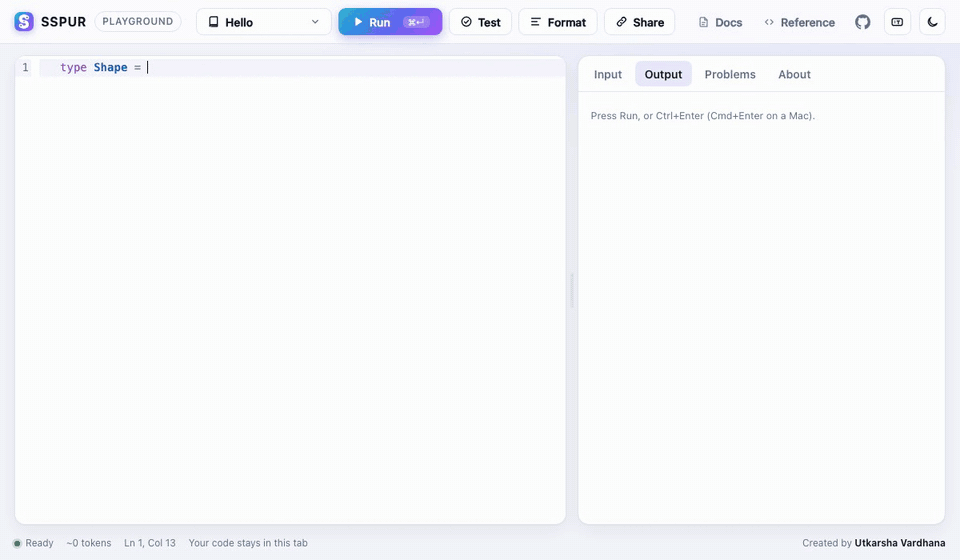

<p align="center"></p>

# SSPUR

[](https://github.com/sspurlang/sspur/actions/workflows/ci.yml)
[](https://sspurlang.github.io/sspur/)
[](https://sspurlang.github.io/sspur-packages/)

**A programming language for AI agents to write, read, and maintain.**

Documentation: **[sspurlang.github.io/sspur](https://sspurlang.github.io/sspur/)**, with [Get Started](https://sspurlang.github.io/sspur/get-started/five-minutes.html), the [Handbook](https://sspurlang.github.io/sspur/handbook/index.html), the [Reference](https://sspurlang.github.io/sspur/reference/language.html) and [Tutorials](https://sspurlang.github.io/sspur/tutorials/index.html). To try it without installing anything, open the **[Playground](https://sspurlang.github.io/sspur/play/)**, which runs the checker and the interpreter in your browser.

Home: **[sspurlang.github.io](https://sspurlang.github.io/)** · Packages: **[sspurlang.github.io/sspur-packages](https://sspurlang.github.io/sspur-packages/)**, the package registry, where you can search packages and publish your own.

**[SSPUR Pulse](https://sspurlang.github.io/sspur/pulse/)** is a live dashboard of the world today, recomputed every 6 hours by SSPUR programs ([how it works](https://sspurlang.github.io/sspur/pulse-how-it-works.html)).

<p align="center"><a href="https://sspurlang.github.io/sspur/play/"></a></p>

SSPUR is a statically typed, effect-tracked language whose primary users are AI coding agents rather than people. Programs are stored as a typed, content-addressed graph of definitions. Agents change code through atomic, typechecked operations instead of text diffs, and the compiler treats contracts, effects, and tests as first-class data. The surface syntax is designed to spend as few tokens as possible while still compiling to native code that outperforms idiomatic C++.

```
type Item = {name: Str, price: Int where _ >= 0, qty: Int where _ > 0}

fn total(items: List[Item]) -> Int
= items.map(_.price * _.qty).sum

fn main() -> Unit ! log
= do
  cart = [Item{name: "pen", price: 3, qty: 4}, Item{name: "book", price: 12, qty: 1}]
  log("total: {total(cart)}")

test empty = total([]) == 0
```

```
$ sspur run cart.ssp
total: 24
$ sspur test cart.ssp
1 passed, 0 failed
```

## Why SSPUR

Most languages are designed around a human at a keyboard. SSPUR starts from a different question: what does a language look like when the author is a model that reads every token, pays for every token, and never gets tired of writing contracts?

- **Fewer tokens for agents.** On 17 multi-step coding tasks, agents writing SSPUR used 0.67x the tokens of the same agents writing Python, and were level with TypeScript and Go (0.98x and 0.89x in total, 1.0x per task at the median), with every hidden test passing in all four languages. On six tasks in codebases of about 1,000 definitions the gap opens up: 0.68x Python, 0.59x TypeScript and 0.58x Go with Sonnet, and cheaper than TypeScript on every task with Opus and Haiku too. SSPUR code is also the smallest of the four. [The full report](bench/agent/README.md) has every task, model and caveat.
- **Every side effect is in the signature.** `log`, `fail[E]`, `db.read[T]`, `fs`, `proc`, `net`, `ffi`, `conc` and user-defined effects are tracked by the checker, so a reviewer, or a deployer, can see exactly what a function is allowed to do.
- **Contracts are checked, not just documented.** `pre`, `post`, and refinement types (`Int where _ > 0`) are enforced at runtime, proved with Z3 where possible, turned into property tests by the fuzzer, and used by the optimizer to remove checks it can prove unnecessary.
- **Edits are atomic.** `sspur edit` replaces definitions by name, typechecks the whole codebase, and either applies everything or nothing. One call can edit and run the tests.
- **Safe and fast by default.** Integer overflow, out-of-bounds access, and contract violations always trap. The native compiler proves most of those checks away, reuses memory in place when values are uniquely owned, frees list buffers and strings at their last use, fuses pipelines into single loops, vectorizes, and runs pure pipelines across cores.

## Features

**Language**
- Records, sum types, generics, pattern matching (or-patterns, list patterns, `e is p` tests, `while e is p` loops, `p = e else d` guards) checked for exhaustiveness, decision tables, and refinement types
- Traits with default methods, bounds such as `[T: Ord + Show]`, operators as traits (`impl Add for Money`), and `derive Eq, Ord, Show, Hash, Json`, all resolved statically
- Lambdas, `_` placeholders, and block lambdas (`xs.map(x => do` and an indented block)
- Packages: `sspur.toml`, `pub` exports, `use lib.{f, T}`, a lock that pins each dependency by the hash of its exports, and a public registry with `sspur add NAME`, `sspur publish` and automated checks
- Algebraic effects with handlers and one-shot `resume`, generators with `yield`
- Errors as typed effects (`raise`, `catch`), with exhaustiveness checking
- Structured concurrency with `par`, `Atomic[Int]`, and channels, with data races rejected by the type checker
- A `sys` profile with owned resources, borrows, deterministic cleanup, and raw pointers behind `unsafe`
- A `bare` profile with no runtime for bare-metal code, memory-mapped I/O, interrupt handlers, fixed arrays, static state with atomic access, inline asm, `F64` on the Arm targets (hardware on aarch64, software double precision on Cortex-M4) and a second aarch64 core, for QEMU riscv64 and aarch64 and Cortex-M4 firmware

**Standard library**
- Collections: `List`, `Map`, `Set`, `HashMap`, `HashSet`, `Heap`, `Bits`, `FlatMap`, `MdSpan`, deques, lazy `View` pipelines, and a broad set of list algorithms
- Text: Unicode strings with locale-independent casing and case folding, explicit `Locale` values for six locales (bundled collation, number and date rules), formatting specifiers, a string builder, and a backtracking-free `Regex`
- Numbers: checked and wrapping integer arithmetic, the full `<cmath>` set, `BigInt`, fixed-point `Dec`, `Complex`, seeded random distributions and a splittable `Rng`
- System: files, streaming `File` handles and directories, stdin, time, calendars and IANA time zones (`Time`, `Duration`, `Zone`), environment, and child processes, each behind its own effect
- `json.encode` and `json.decode[T]` for any data type
- Networking: an HTTP client and an HTTP/1.1 server with TLS behind the `net` effect, where a `svc` is the typed router, with keep-alive, CORS, gzip, static files, health checks, request ids, graceful shutdown, typed `config.load` from files and the environment, and levelled logs with JSON output
- Databases: SQLite built in behind the `db` effect, with typed rows (`db.query[User]`), parameters only by binding, transactions that roll back on raise, migrations, and WAL defaults and a connection pool for concurrent server handlers
- Security: SHA-256 and SHA-512, BLAKE2b, HMAC, XChaCha20-Poly1305 encryption, Argon2id password hashing, Ed25519 signatures, constant-time comparison, tokens and UUIDs, from Monocypher and libsodium, with randomness behind the `rand` effect and keys as `Secret` values
- Data: `Bytes` with hex and base64, gzip, DEFLATE and zstd in memory and streaming between files, and RFC 4180 CSV with typed records (`csv.decode[Row]`) and streaming folds

**Tooling**
- An interpreter, a Cranelift JIT, and an optimizing native compiler (via C and clang) that is the default for `run` and `test`
- Differential fuzzing of native code against the interpreter, and contract-driven property testing
- `sspur verify` for SMT-checked contracts
- Typed holes that fill themselves: `sspur check` lists the small expressions that fit a `?hole` and pass the tests and contracts, and `sspur suggest` proposes `pre` and `post` clauses from runs of a function
- An MCP server and a compact query API so agents can pull exactly the context they need
- `sspur lsp`, a language server with diagnostics, quick fixes, hole filling, completion, hover, signature help, inlay hints, formatting, navigation and rename, and a VS Code extension; Neovim, Vim, Helix, Emacs, Sublime Text, JetBrains IDEs and Eclipse work through their LSP clients, and Zed through an extension with a Tree-sitter grammar ([Editor setup](docs/get-started/editors.md))
- C interop in both directions: `extern fn`, `sspur bind` for C headers, and `sspur export-c` to ship SSPUR as a C library
- `kernel fn` GPU kernels: Metal with exact `F32` and identical traps, queued launches, shared memory and barriers, deterministic atomics, 2D grids and inlined helper fns, plus OpenCL C, SPIR-V and PTX through `sspur gpu`
- `sspur deploy` to generate infrastructure and least-privilege IAM policies from a service's effects, run the service locally, migrate data, hot swap versions, and replay recorded traffic
- Concurrent editing by many agents with typechecked merges, replica sync, and a shared build cache
- [SSPUR Pulse](https://sspurlang.github.io/sspur/pulse/), a live dashboard of the world today, fetched, checked and rendered by SSPUR programs every 6 hours ([source](pulse/), [how it works](docs/pulse-how-it-works.md))

## Performance

Benchmarks run on Apple Silicon against C++ compiled with clang `-O2` with the same safety checks (lower is faster for SSPUR). Full methodology and source are in [`bench/native/`](bench/native/README.md).

| Workload | C++ | SSPUR | SSPUR / C++ | Peak memory, C++ / SSPUR |
|---|---|---|---|---|
| Records, lists, persistent trees, float simulation | 0.82s | 0.11s | 0.14x | 70 MB / 11 MB |
| Pure data pipelines, 10 cores (C++ single-threaded) | 2.11s | 0.31s | 0.15x | 17 MB / 18 MB |
| GPU kernels on Metal: saxpy, reductions, naive and tiled matmul, atomic histogram (C++ single-threaded CPU) | 0.84s | 0.32s | 0.38x | 54 MB / 92 MB |
| Data-parallel numeric kernels | 0.33s | 0.16s | 0.48x | 40 MB / 34 MB |
| Strings: build, split, count, sort 2M words | 0.10s | 0.06s | 0.57x | 22 MB / 24 MB |
| App: generate and parse CSV, aggregate, report | 0.17s | 0.10s | 0.59x | 24 MB / 17 MB |
| Recursion, loops, primes, gcd | 1.02s | 0.91s | 0.89x | 1 MB / 3 MB |

Native code frees list buffers and strings at their last use when the compiler can prove they have one owner (ADR 0033) and a collector reclaims the rest, so peak memory is near or below C++ everywhere except `gpu`, which keeps device buffers and the host copies that make CPU reruns exact. An unchanged program runs from the cached native library without parsing or checking it (ADR 0034): hello world takes 9.6 ms, against 7.2 ms for C.

Compiling C++ with `-O3` instead of `-O2` doesn't change these results.

## Installation

SSPUR runs on macOS (arm64, x86_64), Linux (x86_64, aarch64) and Windows (x86_64, arm64). Native compilation needs `clang` at run time. On macOS it comes with the Xcode Command Line Tools (`xcode-select --install`); on Debian or Ubuntu, `sudo apt install clang`.

### Homebrew

```
brew install utkarshavardhana/sspur/sspur
```

### Install script

Downloads the release tarball for your platform, verifies its SHA-256 checksum and installs `sspur` into `~/.local/bin`:

```
curl -fsSL https://raw.githubusercontent.com/sspurlang/sspur/main/install.sh | sh
```

Set `SSPUR_VERSION=0.14.0` to pin a version, or `SSPUR_INSTALL_DIR` to install somewhere else.

### Windows

In PowerShell, this downloads the release zip, verifies its checksum, installs `sspur.exe` into `%LOCALAPPDATA%\sspur\bin` and adds it to your user `PATH`:

```powershell
irm https://raw.githubusercontent.com/sspurlang/sspur/main/install.ps1 | iex
```

Or unpack `sspur-vX.Y.Z-x86_64-pc-windows-msvc.zip` from a release. Native compilation needs LLVM (`winget install LLVM.LLVM`) and the Visual Studio Build Tools; see [installation](https://sspurlang.github.io/sspur/get-started/installation.html#windows).

### Prebuilt binaries

Each [release](https://github.com/sspurlang/sspur/releases) has tarballs for `aarch64-apple-darwin`, `x86_64-apple-darwin`, `x86_64-unknown-linux-gnu` and `aarch64-unknown-linux-gnu`, zips for `x86_64-pc-windows-msvc` and `aarch64-pc-windows-msvc`, the editor files below, and a `SHA256SUMS` file:

```
shasum -a 256 -c SHA256SUMS --ignore-missing
tar -xzf sspur-v0.14.0-aarch64-apple-darwin.tar.gz
sudo install sspur-v0.14.0-aarch64-apple-darwin/sspur /usr/local/bin/
```

### From source

You need Rust 1.88 or newer and `clang`. From a clone of the repository:

```
cargo install --path crates/sspur-cli
```

or build in place:

```
git clone https://github.com/sspurlang/sspur.git
cd sspur
cargo build --release
export PATH="$PWD/target/release:$PATH"
```

### Optional tools

| Tool | Used for |
|---|---|
| `z3` | `sspur verify` and SMT-based check elimination |
| `qemu`, `lld` | building and booting `profile bare` kernels; `lld` also for `--lto` on Linux and Windows |
| libcurl headers (`libcurl4-openssl-dev` on Debian or Ubuntu) | `sspur deploy local` on Linux (macOS has them; on Windows the local host needs none) |
| libcurl (`libcurl4` on Debian or Ubuntu) and OpenSSL 3 | The HTTP client on Linux (macOS ships libcurl; Windows uses WinHTTP), and HTTPS in `http.serve` (`brew install openssl@3` on macOS; Linux has it) |
| Homebrew `llvm` | `sspur gpu --emit spirv` and `--emit ptx` (Apple's clang has neither backend) |

On macOS: `brew install z3 qemu llvm lld`. On Ubuntu: `sudo apt install z3 qemu-system-misc qemu-system-arm lld llvm`. GPU kernels run on Metal on macOS and on the C fallback elsewhere.

### Editors

`sspur lsp` is a language server: errors as you type, quick fixes, hole filling, completion, hover, signature help, inlay hints, formatting, go to definition and rename. Each release has the files for these editors, and none of them needs an account or a marketplace:

- **VS Code**, and Cursor, Windsurf and VSCodium: download `sspur-vX.Y.Z.vsix` and run `code --install-extension sspur-vX.Y.Z.vsix` (or *Extensions: Install from VSIX...*).
- **JetBrains IDEs** (IntelliJ IDEA, PyCharm, GoLand, RustRover, WebStorm, CLion): install the free LSP4IJ plugin, download and unzip `sspur-lsp4ij-vX.Y.Z.zip`, then in *Settings > Languages & Frameworks > Language Servers* click **+**, **Import template...** and pick the `sspur` folder.
- **Zed**: download and unzip `sspur-zed-vX.Y.Z.zip`, then run **zed: install dev extension** and pick the `sspur-zed` folder.

[Editor setup](https://sspurlang.github.io/sspur/get-started/editors.html) has these in detail, plus Neovim, Vim, Helix, Emacs, Sublime Text and Eclipse.

## Getting started

Run, test, and check a file:

```
sspur run   tests/programs/core.ssp
sspur test  tests/programs/core.ssp
sspur check tests/programs/core.ssp      # add --json for machine-readable diagnostics
sspur fmt   tests/programs/core.ssp
```

Start a web app: the reference application, a notes service with accounts, SQLite, sessions and its own tests ([tutorial](https://sspurlang.github.io/sspur/tutorials/web-app.html)):

```
sspur new web-app notes && cd notes && sspur run
```

Find bugs and prove properties:

```
sspur fuzz tests/programs/core.ssp                      # contracts become property tests
sspur fuzz --differential tests/programs/core.ssp       # native code versus the interpreter
sspur verify tests/programs/contracts.ssp               # prove pre/post/where with Z3
```

Work on a codebase the way an agent does:

```
sspur init tests/programs/core.ssp         # import into a .sspur/ codebase
sspur q pack try_place --budget 400        # smallest context needed to edit a function
sspur edit --test -e 'fn total(items: List[Item]) -> Int = items.map(_.price * _.qty).sum'
sspur log
```

### Packages

A package is a directory with an `sspur.toml`. `pub` marks what it exports; dependents write `lib.f(x)` and `lib.T`, or import names with `use lib.{f, T}`. A dependency is pinned in `sspur.lock` by the hash of its exports, so a build never changes until you upgrade, and its effects and contracts show up in your own signatures.

```
sspur add ../textutils                      # or a git URL: sspur add file:///srv/textutils.git@v0.1.0
sspur deps tree
sspur deps update                           # semantic diff; refused if it breaks your code (--force to override)
sspur q sig textutils.clip                  # a dependency's signature, without its body
```

Published packages come from the registry, [sspur-packages](https://sspurlang.github.io/sspur-packages/): a GitHub repository with one file per package, free to run and checked on every publish (types, tests in both tiers, effects, docs, the API diff against the last version, licence, secrets). Each version is pinned by its commit, a source snapshot's SHA-256 and its export hash, and installing one never runs its code.

```
sspur search money
sspur add money@^1.2                        # sspur update moves to the newest matching version
sspur add acme/money --as acme_money        # a scoped name: acme is the GitHub owner that publishes it
sspur publish                               # the registry's checks, then the request on GitHub
```

See the [Packages](https://sspurlang.github.io/sspur/handbook/packages.html) and [Publishing a package](https://sspurlang.github.io/sspur/handbook/publishing.html) chapters of the handbook, [`examples/packages/`](examples/packages), [ADR 0026](docs/adr/0026-packages.md) and [ADR 0038](docs/adr/0038-package-registry.md).

More examples:

| Example | What it shows |
|---|---|
| [`templates/web-app/`](templates/web-app) | The reference app that `sspur new web-app` writes: accounts, notes, SQLite, CSRF, rate limits, end-to-end tests, systemd and Caddy files |
| [`examples/crud/`](examples/crud) | A CRUD HTTP service, with `sspur deploy plan` and `sspur deploy local` |
| [`examples/ffi/`](examples/ffi) | Calling libc and libm, and calling SSPUR from C |
| [`examples/packages/`](examples/packages) | A text library and an app that depends on it by path, with its lockfile |
| [`examples/bare/`](examples/bare) | Bare-metal hello world on QEMU riscv64 and aarch64 and a Cortex-M4 (MPS2 AN386); [`tests/bare/`](tests/bare) adds a timer interrupt, inline asm, statics shared with an interrupt handler, floats and two cores |
| [`tests/programs/`](tests/programs) | 16 runnable programs, one per area, covering every language feature and library area |

## Using SSPUR with AI agents

Agents need only a short reference to write SSPUR. Point them at it with:

```
sspur start [NAME...] # the core agent spec (0.6k tokens) plus the codebase, or q pack of NAMEs if it is large
sspur spec            # the compact agent reference alone
sspur spec --full     # the complete language reference
sspur mcp             # serve the codebase over the Model Context Protocol
```

The recommended loop is one call per change: read what you need with `sspur q`, then `sspur edit --test` with all the definitions for the change. The command prints a single line on success, or precise `def:line:col CODE message` diagnostics with fix hints, and leaves the codebase untouched if anything fails. In a large codebase, `sspur q find 'ship|tax_*'` lists matching names with their signatures and `sspur q grep TEXT` the definitions that contain TEXT, so an agent never has to print the whole listing. `sspur q pack A,B,C` returns each of several definitions with the types and signatures it uses, its tests and its callers, so one call can carry everything a change needs.

- **MCP clients** (Claude Code, Claude Desktop, any stdio client): `claude mcp add sspur -- sspur mcp`, or see [docs/agent/mcp.md](docs/agent/mcp.md) for the Desktop config, `--dir`, and the tool list.
- **Claude Code plugin**: [`packaging/claude-code/`](packaging/claude-code/) bundles the MCP server with a skill that teaches the workflow and loads for `.ssp` files and SSPUR questions. Install it with `claude plugin marketplace add sspurlang/sspur` and `claude plugin install sspur@sspur`.

## Documentation

The documentation is an mdBook in [`docs/`](docs/), published at [sspurlang.github.io/sspur](https://sspurlang.github.io/sspur/). Every code block in the handbook and tutorials is a file in [`docs/snippets/`](docs/snippets/) that CI runs against the current compiler.

| Section | Contents |
|---|---|
| [Playground](https://sspurlang.github.io/sspur/play/) | Check, run, test and format programs in the browser, with completions, hover types and quick fixes from the compiler. Its source is [`docs/play/`](docs/play/) and [`crates/sspur-wasm`](crates/sspur-wasm/); `tools/build_playground.sh` builds it |
| [Get Started](https://sspurlang.github.io/sspur/get-started/five-minutes.html) | SSPUR in 5 minutes, pages for [TypeScript](https://sspurlang.github.io/sspur/get-started/from-typescript.html), [Python](https://sspurlang.github.io/sspur/get-started/from-python.html) and [Go and Rust](https://sspurlang.github.io/sspur/get-started/from-go-rust.html) programmers, [SSPUR for AI agents](https://sspurlang.github.io/sspur/get-started/agents.html) and [installation](https://sspurlang.github.io/sspur/get-started/installation.html) |
| [Editor setup](https://sspurlang.github.io/sspur/get-started/editors.html) | `sspur lsp` in VS Code (the extension in [`packaging/vscode/`](packaging/vscode/)) and its forks, Zed (the extension in [`packaging/zed/`](packaging/zed/)), Neovim, Vim, Helix, Emacs, Sublime Text, JetBrains IDEs, Kate and Eclipse |
| [Handbook](https://sspurlang.github.io/sspur/handbook/index.html) | The language in fifteen pages, from the basics to traits, concurrency, networking, databases, crypto and packages |
| [Reference](https://sspurlang.github.io/sspur/reference/language.html) | The [full language reference](docs/reference/language.md) (what `sspur spec --full` prints), the [standard library](https://sspurlang.github.io/sspur/reference/stdlib.html), [effects](https://sspurlang.github.io/sspur/reference/effects.html), [error codes](https://sspurlang.github.io/sspur/reference/errors.html), the [command line](https://sspurlang.github.io/sspur/reference/cli.html), the [agent reference](docs/agent/agent-spec.md) and [JSON schemas](https://sspurlang.github.io/sspur/reference/schema.html) |
| [Tutorials](https://sspurlang.github.io/sspur/tutorials/index.html) | A web app with accounts (`sspur new web-app`), a CRUD service, migrations and hot swap, calling C, bare metal, GPU kernels, and a multi-agent codebase |
| [Project Configuration](https://sspurlang.github.io/sspur/config/sspur-toml.html) | `sspur.toml`, `sspur.lock`, build options and environment variables |
| [Cheat Sheet](https://sspurlang.github.io/sspur/cheat-sheet.html) | The everyday syntax on one page |
| [Design and Performance](https://sspurlang.github.io/sspur/design/index.html) | The [design documents](docs/design/), the [decision records](docs/adr/), and the native and agent benchmarks |

## Project status

SSPUR is at version 0.14 and under active development. The language and tools are usable, but the syntax and standard library may still change between releases.

| Phase | Status |
|---|---|
| 1. Design and token benchmark | Done |
| 2. Compiler core and spec-only model evaluation | Done |
| 3. Agent loop: codebase, transactions, queries, MCP, effect handlers | Done |
| 4. Native compiler, `sys` profile, ownership, concurrency, SMT contracts | Done |
| 5. Bare-metal profile, SIMD, C interop, LLVM, PGO and LTO, inline asm, embedded | Done: C through clang stays the production path (a direct LLVM IR prototype was measured at 0.98x to 1.04x, ADR 0024), opt-in PGO and explicit LTO, inline asm, a Cortex-M4 firmware target, fixed arrays and static state shared with interrupt handlers; real boards beyond QEMU and a board description format remain |
| 6. Deployment, migrations, hot swap, replay, GPU kernels, standard library | Mostly done: all 23 C++ library areas covered (locale for six bundled locales); first real AWS deploy, canary, backfill and rollback verified end to end (ADR 0016, ADR 0019) |
| 7. Multi-agent sync, replica sync, global build cache, proven rewrites, cost-driven optimization | Done: 100 concurrent agents with no lost work, per-definition native objects, proven rewrites with `sspur explain-opt`, cost-driven inlining and fusion; an authenticated sync server remains |

See the [roadmap](docs/design/roadmap.md) for details and exit criteria.

## Repository layout

| Path | Contents |
|---|---|
| `crates/sspur-syntax` | Lexer, parser, printer, AST |
| `crates/sspur-check` | Type, effect, contract, and ownership checker |
| `crates/sspur-eval` | Reference interpreter and fuzzer |
| `crates/sspur-native` | Cranelift JIT and the native C compiler with its runtime |
| `crates/sspur-smt` | SMT encoding and Z3 integration |
| `crates/sspur-store` | Content-addressed codebase, transactions, queries, packages |
| `crates/sspur-cli` | The `sspur` command, MCP server, language server, deployer |
| `crates/sspur-deploy` | The deployer: CloudFormation and IAM from effects, migrations, the local Lambda and DynamoDB emulator, replay |
| `crates/sspur-hash` | Name resolution and content hashing of definitions |
| `crates/sspur-ide` | Editor support shared by the language server and the playground: diagnostics with fixes, completion, hover, signature help, inlay hints, navigation, highlighting |
| `crates/sspur-wasm` | The checker, formatter and interpreter compiled to WebAssembly for the playground |
| `docs/` | The documentation site (mdBook, `docs/book.toml`): handbook, reference, tutorials, design docs and ADRs, the agent spec that `sspur spec` embeds, the JSON schemas, and `docs/snippets/`, the checked code every page includes |
| `examples/` | Small complete programs: hello, a CRUD service, C interop, packages |
| `tests/` | Suite programs, the ownership soundness suite, bare-metal, GPU and fuzz regression tests |
| `bench/` | Benchmarks: `native/` against C++, `agent/` and `eval/` for agents, `incremental/`, `llvm/`, and `tokens/`, the Phase 1 token count |
| `packaging/` | The Homebrew formula and Scoop manifest templates, the Claude Code plugin (`packaging/claude-code/`), the VS Code extension (`packaging/vscode/`), the LSP4IJ template for JetBrains IDEs (`packaging/jetbrains/`) and the Zed extension with its Tree-sitter grammar (`packaging/zed/`) |
| `tools/` | The corpus differential check, the site link check, and the playground build and its smoke test, all run by CI |

## Contributing

Bug reports and design discussion are welcome as GitHub issues. Every change has to keep the full test suite passing and leave native output identical to the interpreter. [CONTRIBUTING.md](CONTRIBUTING.md) lists the build, test and corpus checks, [SECURITY.md](SECURITY.md) explains how to report a vulnerability, and [CHANGELOG.md](CHANGELOG.md) has the release notes.

## Author

SSPUR is designed, written, and maintained by [Utkarsha Vardhana](https://github.com/utkarshavardhana). The name comes from the initials of my family.

## License

SSPUR is dual-licensed under either of

- [MIT license](LICENSE-MIT)
- [Apache License, Version 2.0](LICENSE-APACHE)

at your option. Unless you explicitly state otherwise, any contribution you submit for inclusion in SSPUR is dual-licensed as above, without any additional terms or conditions.

Copies and derived works must keep the copyright notice and the [NOTICE](NOTICE) file. The licenses cover the code, not the SSPUR name: a fork needs its own name.

Copyright © 2026 Utkarsha Vardhana.
